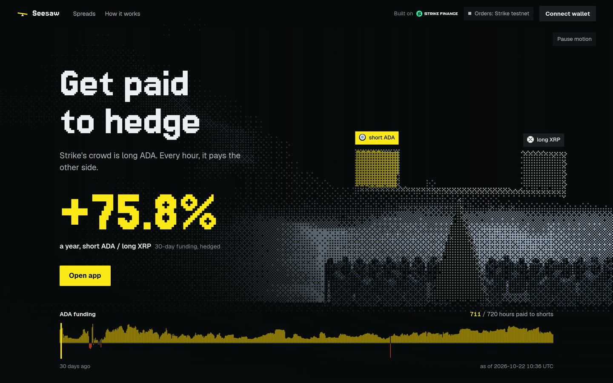
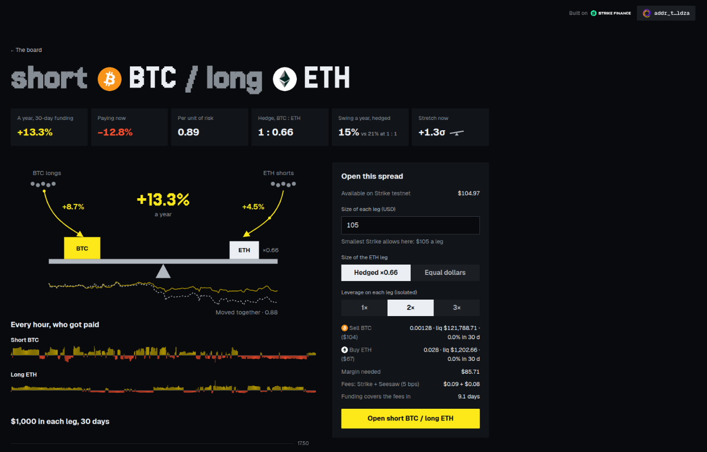
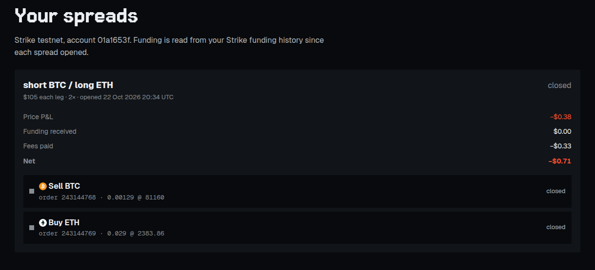
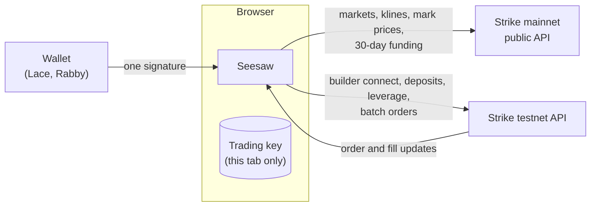

# Seesaw

**Get paid to hedge on Strike.** Seesaw finds the Strike spreads that funding pays you to hold, then opens both legs in one click.

[Live app](https://seesaw.timidan.xyz) · [One-minute tour](https://seesaw.timidan.xyz/story.html) · Built for the Strike Hackathon, October 2026



## The idea

On Strike, the crowd usually leans one way. To keep each perpetual near its spot price, the crowded side pays the other side **funding** every hour. In the current 30-day snapshot, ADA longs paid ADA shorts in 711 of 720 hours.

Collecting that funding by shorting ADA alone means carrying all of ADA's price risk. A **spread** removes most of it: short the coin the crowd is long, and go long a coin that moves with it, sized by the hedge ratio. When the market moves, both legs move together, and the funding keeps arriving.

## What Seesaw does

1. **Ranks every pair of Strike markets** (465 pairs from 32 markets in the current snapshot) as "short A / long B", by the funding it paid over 30 days per unit of hedged risk.
2. **Explains each spread on its own page:** hourly funding for both legs, the price ratio against its 30-day mean, a carry calculator, the hedge ratio, how often funding flipped sign, how fast the spread mean-reverts, and the odds of each leg being liquidated.
3. **Opens both legs in one click** through Strike's builder codes, with isolated margin and leverage set on each leg first.
4. **Tracks the spread as one position:** price P&L, funding received, fees, and a single action to close both legs.



## Try it on Strike testnet

Orders go to **Strike testnet**. Two wallet routes have been tested end to end:

| Wallet | Network | Test funds | Deposit asset |
|---|---|---|---|
| Lace (Cardano) | Preprod | [Cardano testnet faucet](https://docs.cardano.org/cardano-testnets/tools/faucet) | ADA |
| Rabby or MetaMask (EVM) | Sepolia | [Circle faucet](https://faucet.circle.com) for USDC, plus a little Sepolia ETH for gas | USDC |

1. Open the **short BTC / long ETH** spread. Strike testnet's ADA order book is empty, so BTC and ETH are the markets whose testnet books fill near the mark price. The board marks them with a `testnet` tag.
2. **Connect a wallet** with the button in the header (Lace, Rabby, Phantom and other installed wallets are listed) and sign one message. It approves the builder code `Seesaw` and creates a trading key for this browser tab. That key can place orders but cannot withdraw.
3. **Deposit from the ticket** if the balance is short. The smallest BTC/ETH spread ($105 BTC / $69 ETH) needs about $87 of margin at 2×. 500 test ADA credited $105.69 during testing; the ticket quotes the exact amount before you sign.
4. **Open the spread.** Both orders go out in one batch request, and each leg reports its own fill.
5. **Close both legs** from the spread card under "Your spreads".

### Verified runs (22 October 2026)

| Wallet and funding | Orders | Result |
|---|---|---|
| Rabby, 60 USDC from Sepolia | 243144083 (sell BTC), 243144084 (buy ETH) | Both filled, then closed |
| Lace, 500 ADA from Preprod | 243144768 (sell BTC), 243144769 (buy ETH) | Both filled, then closed (net −$0.71 after fees) |



## How it works

Seesaw is one static site with no backend. Rankings use Strike **mainnet** public market data; trading uses the Strike **testnet** API.



### Integration with Strike

| Strike feature | What Seesaw uses it for | Code |
|---|---|---|
| Price API: `exchangeInfo`, `klines` (1 h, 720), `premiumIndex`, `depth` | Market list, hourly returns for hedge ratios and volatility, live funding and marks, and which testnet books can fill | `src/carry/data.ts`, `src/carry/execMarkets.ts`, `src/ui/data.ts` |
| Stats API: 30-day funding history | Carry, hours paid, sign flips, the 72-hour "paying now" rate | `src/carry/data.ts`, `scripts/snapshot.ts` |
| Builder Connect with a client Ed25519 API wallet | One signature lets Seesaw trade for the account; the API wallet cannot withdraw | `src/api/builderConnect.ts`, `src/session/useBuilderConnect.ts` |
| Builder code `Seesaw` and `X-Builder-Fee-Bps: 5` | A 5 bps builder fee on both legs of every spread | `.env.production`, `src/api/config.ts` |
| Leverage and margin mode per symbol | Isolated margin and the chosen leverage are set and confirmed on both legs before any order | `src/spread/engine.ts` |
| `/v2/orders/batch` | Both legs in one request | `src/spread/engine.ts` |
| User WebSocket | Per-leg order and fill state | `src/spread/useSpreads.ts`, `src/ws/` |
| Deposits: quote, build transaction, wallet signs, confirm | Funding the account from the ticket, for Cardano (ADA) and EVM (USDC) wallets | `src/session/useDeposit.ts`, `src/ui/DepositInline.tsx` |
| Public positions, fills and funding by account | An optional read-only live spread for visitors without a wallet (set `VITE_DEMO_ACCOUNT_ID`; off in the current build) | `src/spread/publicSpread.ts`, `src/ui/LiveSpread.tsx` |
| Market icons and logo | Coin and stock icons across the app | `src/ui/Coin.tsx` |

## Hackathon criteria

### Innovation and creativity

- A funding-carry screener for a perps order book that ranks spreads by **carry per unit of risk** after a beta hedge, not by raw funding. Raw funding favours the most volatile pairs; per-risk ranking favours spreads you can actually hold.
- A 72-hour "paying now" rate next to the 30-day figure, so a spread that has stopped paying is visible before you open it.
- The interface is built from Strike's own data. The hero tape prints one tick per real hour of funding, the board's mini tapes are 30 days of real funding, and the carry machine's numbers come from the same snapshot. No figure on the page is invented.

### Utility and impact

- **For traders:** a market-neutral way to earn funding, with the risk stated in plain numbers: hedge ratio, hedged versus unhedged swing, how often funding flipped, mean-reversion half-life, and liquidation odds per leg.
- **For Strike:** spreads add size on the uncrowded side of one-sided books, which pulls funding back toward balance, and every order carries a builder fee.

### Technical execution

- **Maths** in `src/carry/math.ts`, checked by `npm test`:
  - hedge ratio as cov/var of hourly log returns;
  - hedged volatility and beta-weighted carry;
  - carry per unit of risk;
  - 72-hour EWMA of funding;
  - 7-day sign flips;
  - Ornstein–Uhlenbeck half-life of the log price ratio;
  - first-passage liquidation probability `1 − erf(k / (σ√(2h)))`;
  - fee break-even days.
- **Two legs that are not atomic.** The batch returns per-leg results and the user stream reports fills. If one leg is rejected, the card names it and offers to retry that leg or close the other one (`src/spread/engine.ts`, `src/spread/legs.ts`).
- **Orders that Strike will accept.** The ticket starts at the smallest size Strike allows on both legs. A testnet market is offered only when its book has at least $40 on each side in the top five levels, and its best bid and ask sit within 2% of the mark price.
- **Fast first paint.** `npm run snapshot` writes `public/snapshot.json` at build time; the page then refreshes live funding on top.

### Future potential

- **Mainnet:** the code path is the same; builder code registration on mainnet is free (confirmed by Strike).
- A Strike vault that holds the top-ranked spreads and rebalances when "paying now" turns negative.
- Alerts when a held spread flips sign or its hedge ratio drifts.

## Security and privacy

- Seesaw has no backend, no accounts and no analytics.
- The trading key (Strike's API wallet) is generated in the browser and kept in `sessionStorage`, so it lasts only as long as the tab. It can place orders but cannot withdraw without the wallet's own signature, as in Strike's reference app.
- Orders, deposits and account reads go directly from the browser to Strike's API.

## Limits

- Orders go to Strike testnet. Its ADA book is empty, so testnet trading uses BTC and ETH. At the time of writing, BTC/ETH was paying negative funding over the last 72 hours; the app shows that in red.
- Past funding is not a forecast. A hedge reduces price risk; it does not remove it.
- The two orders are sent together but fill separately.
- Solana wallets (Phantom, Solflare) are wired for connection and deposits but have not been tested end to end.

## Run locally

Requires Node.js 18 or later.

```bash
npm install
npm run dev        # http://localhost:5173 (tour: /story.html)
npm test           # maths checks
npm run snapshot   # refresh public/snapshot.json from Strike mainnet
npm run build      # typecheck and production build
```

| Variable | Default | Purpose |
|---|---|---|
| `VITE_API_URL` | `https://api-v2-testnet.strikefinance.org` | Strike API used for trading (testnet by default) |
| `VITE_BUILDER_CODE` | `Seesaw` in `.env.production` | Builder code sent with every order |
| `VITE_BUILDER_FEE_BPS` | `5` in `.env.production` | Builder fee per order, in basis points |
| `VITE_DEMO_ACCOUNT_ID` | unset | Optional public account shown as a read-only live spread |

The price, WebSocket and stats endpoints follow the same pattern; see `src/api/config.ts`.

## Project structure

```
src/
  carry/     ranking: data loading, hedge maths, snapshot types
  spread/    execution: batch orders, per-leg state, P&L, public reads
  api/       Strike REST client, auth signing, wallets, deposits
  session/   wallet session, builder connect, deposit flow
  ws/        price and user WebSocket streams
  ui/        pages and components (home, board, spread page, ticket)
  story/     the one-minute tour page
scripts/     snapshot builder and maths checks
```

## Credits

- Started from Strike's builder reference app (first commit, `c4d9ce8`); its API, WebSocket and engine-maths modules are reused.
- Charts: [TradingView Lightweight Charts™](https://www.tradingview.com/). Market icons and logo: Strike.
- Storm footage: Mixkit, free licence (`public/footage/SOURCES.md`).
- Fonts: Jersey 15 and Geist (SIL Open Font License). Isometric drawing kit: MIT (`src/iso/LICENSE`).
- The tour page's scroll engine is adapted from the scroll-world skill; its stills were generated with gpt-image-2.
